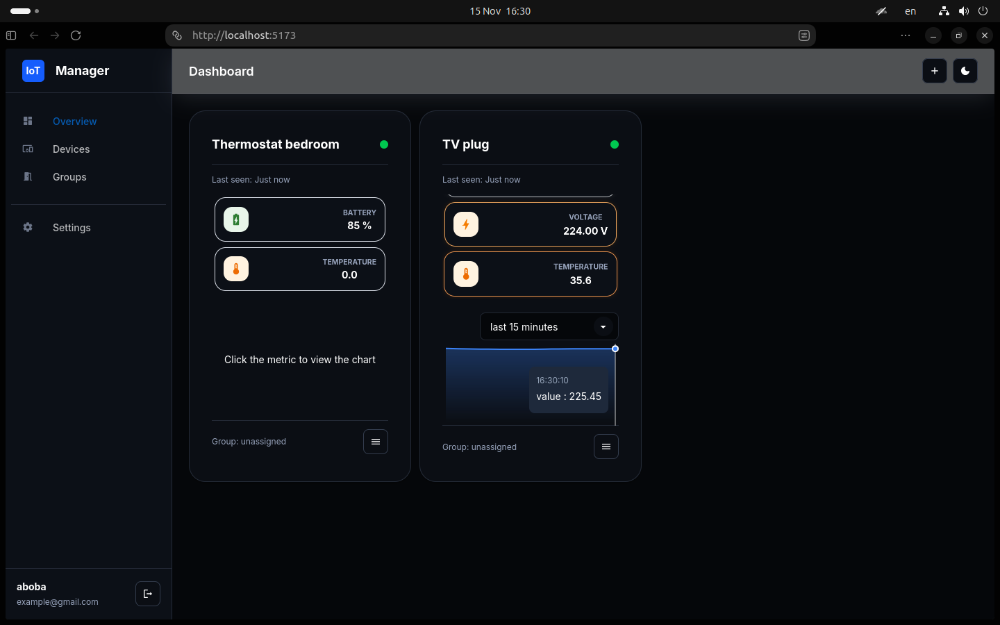
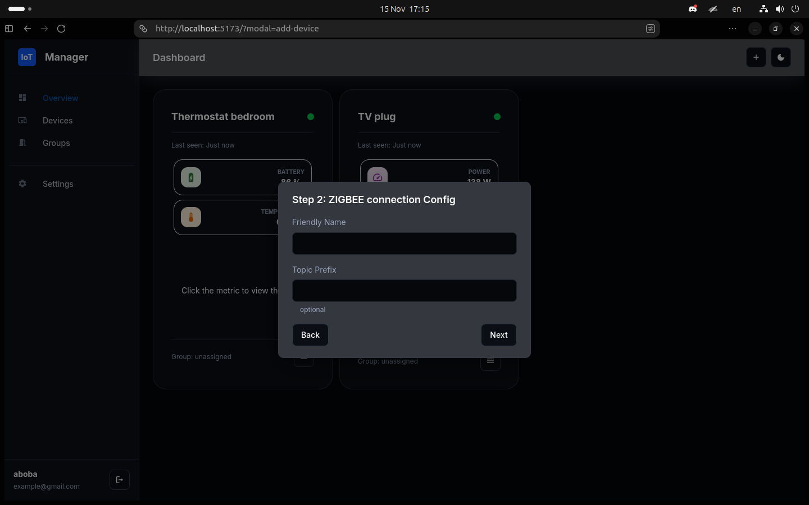

# IoT-Manager 🚀

This project is a scalable IoT management platform designed for smart home enthusiasts and administrators to seamlessly connect, monitor, and control diverse devices (Zigbee, MQTT) through a single, unified dashboard. It solves the problem of hardware fragmentation by abstracting device communication via real-time digital twins (Device Shadows) and profile-driven UI. The full-stack solution is powered by a reactive React/Zustand frontend and a robust NestJS microservices backend utilizing PostgreSQL, InfluxDB, Redis, RabbitMQ, and gRPC.

---

## 📌 Table of Contents

- [Architecture](#-architecture--data-flow)
- [Monorepo Structure](#-monorepo-structure)
- [Tech Stack](#-tech-stack)
- [Preview](#-preview)
- [Quick Start](#-quick-start)
- [Environment Variables](#-environment-variables)
- [Services Overview](#-services-overview)

---

### 📐 Architecture & Data Flow

- **Frontend (React)** — Communicates with the backend via REST API (TanStack Query) for configuration and maintains a persistent Server-Sent Events (SSE) connection for real-time dashboard updates.
- **API Gateway** — Acts as the single entry point. It handles JWT validation, routes synchronous requests to internal microservices via gRPC, and multiplexes RabbitMQ events into the SSE stream.
- **Microservices**:
  - `auth-service` — Handles user authentication, registration, and JWT token issuance.
  - `device-service` — Manages relational state (PostgreSQL). Responsible for CRUD operations on Devices and Device Profiles (rich metadata containing metric mappings and capabilities).
  - `iot-broker-service` — The core integration engine. Connects to the MQTT Broker, normalizes raw hardware payloads into standardized telemetry using dynamic profiles, maintains the Device Shadow (current state) in Redis, routes normalized events to RabbitMQ, and translates UI commands back into hardware-specific MQTT payloads.
  - `statistics-service` — The time-series data sink. Consumes high-throughput telemetry streams from RabbitMQ and persists them into InfluxDB for historical analysis and chart rendering.

### 📦 Monorepo Workspace Packages

To ensure code reusability, maintain strict typing across boundaries, and enforce a Single Source of Truth, shared logic and contracts are extracted into dedicated workspace packages:

- `packages/proto` — Contains Protocol Buffer (`.proto`) files and auto-generated TypeScript types. Acts as the definitive contract for all internal gRPC communication between microservices.
- `packages/nest-libs` — A shared library containing reusable NestJS modules, custom decorators, validation schemas (Class Validator), standardized DTOs, and global enums (e.g., `DeviceProtocol`). Eliminates code duplication across all NestJS microservices.

---

## 📂 Monorepo Structure

```
.
├── apps
│   ├── auth-service
│   ├── device-service
│   ├── iot-broker-service
│   ├── server
│   ├── simulator
│   ├── statistics-service
│   └── web
├── docker-compose.yaml
├── mosquitto
│   ├── config
│   ├── data
│   └── log
├── init-scripts
│   ├── 01-create-databases.sh
│   └── 02-restore-devise-profiles.sh
├── package.json
├── packages
│   ├── nest-libs
│   └── proto
├── pnpm-lock.yaml
├── pnpm-workspace.yaml
├── README.md
├── seeds
│   └── device_profiles_seed.sql
└── turbo.json
```

## 🛠 Tech Stack

- **Frontend:** React (Vite), TypeScript, Material UI (MUI), Tailwind CSS, Zustand (State Management), TanStack Query (Data Fetching).
- **Backend:** Node.js, NestJS, TypeScript, Zod / class-validator.
- **Database & Messaging:** PostgreSQL, Redis, InfluxDB, RabbitMQ , Eclipse Mosquitto (MQTT Broker).
- **Architecture:** Microservices, Event-Driven Architecture, CQRS (Command Query Responsibility Segregation), Server-Sent Events (SSE).
- **DevOps & Tools:** Docker, Docker Compose, Turborepo (Monorepo), pnpm.

## 📷 Preview

|          Dashboard & Live Metrics           |                Add Device Wizard                |
| :-----------------------------------------: | :---------------------------------------------: |
|  |  |

## 🚀 Quick Start

### Prerequisites

Make sure you have the following installed:

- [Git](https://git-scm.com/)
- [Docker](https://www.docker.com/) & [Docker Compose](https://docs.docker.com/compose/)
- [Node.js](https://nodejs.org/) (v18+) and [pnpm](https://pnpm.io/)

### Running the System

1. **Clone the repository:**

   ```bash
   git clone https://github.com/Polaris35/IoT-Manager.git
   cd IoT-Manager
   ```

2. **Install dependencies:**
   ```bash
   pnpm install
   ```
3. **Set up environment variables:**
   ```bash
   cp .env.example .env
   ```
4. **Start services:**

   ```bash
   docker compose up -d
   ```

   4.1. **If you want to simulate devices, run the following commands:**

   ```bash
   pnpm install
   ```

   ```bash
   pnpm dev --filter=simulator
   ```

5. **Access the application:**
   - **Frontend (UI):** http://localhost:5173
   - **API Gateway (Swagger UI):** http://localhost:3000/api/swagger

## 🧩 Services Overview

| **Service**        | **Path**                   | **Tech**      | **Description**                                                      |
| ------------------ | -------------------------- | ------------- | -------------------------------------------------------------------- |
| **Web UI**         | `/apps/web`                | React / Vite  | User dashboard for monitoring metrics and device management.         |
| **API Gateway**    | `/apps/server`             | NestJS        | Single entry point. REST API, Auth Guard, and SSE Stream aggregator. |
| **Auth Service**   | `/apps/auth-service`       | NestJS / gRPC | JWT generation, password hashing, and user management.               |
| **Device Service** | `/apps/device-service`     | NestJS / gRPC | Postgres CRUD operations for devices and rich hardware profiles.     |
| **IoT Broker**     | `/apps/iot-broker-service` | NestJS / MQTT | Core engine. Subscribes to MQTT, updates Redis Shadows, parses JSON. |
| **Statistics**     | `/apps/statistics-service` | NestJS / RMQ  | Consumes RabbitMQ telemetry queue and writes to InfluxDB.            |
| **Simulator**      | `/apps/simulator`          | Node.js       | Script to emulate Zigbee and Tasmota devices for testing purposes.   |
